# 旺财宝 · 截图式页面跳转清单

2026 年 11 月 2 日更新。主流程 A 是首次开通，主流程 B 是日常经营分析；其余为按需支线。截图为真实原型页面，中间未单独截图的步骤明确写在箭头文字中。

## 主流程总览 · 开通 → 看经营 → AI 分析

首次开通走 A1 → A2 → A3，进入首页后走 B。核心闭环是：查看经营 → 发现变化 → AI 分析 → 继续追问并获取建议。正式产品已开通商家日常直接进首页；当前原型每次加载仍展示欢迎页。

| 当前页面 | 点击动作与条件 | 目标页面 |
| --- | --- | --- |
| A · 首次开通 | 完成商家认证（A1–A3） → 审核通过后扫码绑定 → 确认设备与商家 → 首页 | B · 首页查看经营 |
| B · 首页查看经营 | 点击「AI助手」 → 或经营画像 / AI 洞察 → 进入分析并继续追问 | B · AI 分析与追问 |

主流程终点：理解变化、获得经营建议，并可继续追问。查账、历史回看、渠道签约与设置均为按需支线。

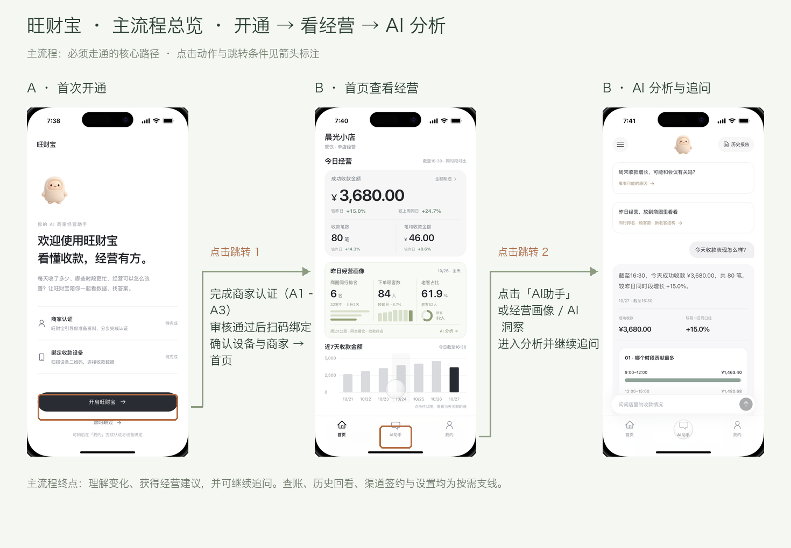

## 主流程 A1 · 开始商家认证

图中主线为小微商户。个体、企业选择后先添加相应营业执照，再进入身份证步骤。欢迎及认证过程均可手动暂时跳过至首页。

| 当前页面 | 点击动作与条件 | 目标页面 |
| --- | --- | --- |
| 欢迎页 | 点击「开启旺财宝」 | 选择商户类型 |
| 选择商户类型 | 选择「小微商户」 → 点击「开始准备资料」 | 经营者身份证 |

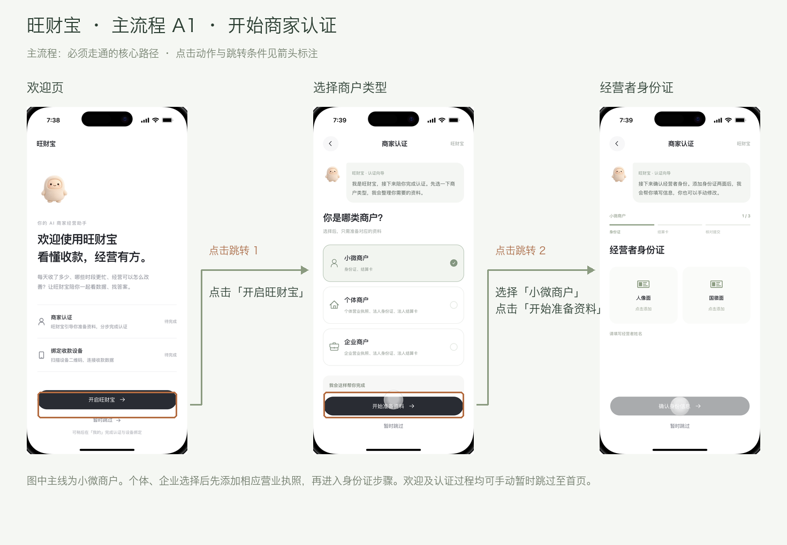

## 主流程 A2 · 资料识别与核对

截图展示待添加资料状态；必须先完成识别并核对信息，底部确认按钮才可点击。缺项、持卡人姓名不一致时停留当前步骤，不跳转。

| 当前页面 | 点击动作与条件 | 目标页面 |
| --- | --- | --- |
| 身份证资料 | 添加身份证两面 → 识别并核对姓名、号码 → 点击「确认身份信息」 | 结算卡资料 |
| 结算卡资料 | 添加结算卡并核对 → 点击「确认结算卡信息」 | 脱敏资料汇总 |

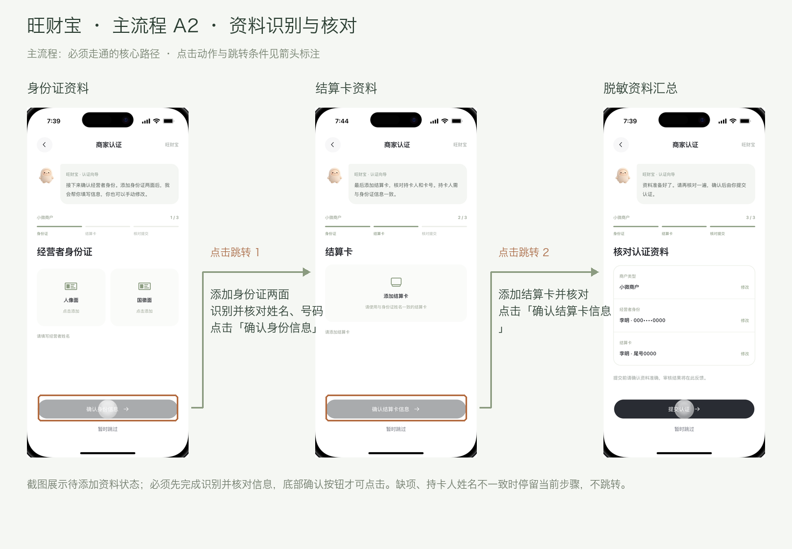

## 主流程 A3 · 审核通过与绑定设备

左侧到中间并非一步直达：提交后先显示审核中，查看结果通过后才能继续绑定。识别完成不等于认证通过；扫码后仍需确认设备与商家。

| 当前页面 | 点击动作与条件 | 目标页面 |
| --- | --- | --- |
| 核对认证资料 | 「提交认证」→ 审核中 → 「查看认证结果」→ 通过 → 「继续绑定设备」 → 点击「扫码绑定设备」 | 扫码弹层 |
| 扫码弹层 | 点击「识别设备二维码」 → 核对设备与商家 → 点击「确认绑定并完成」 | 进入经营首页 |

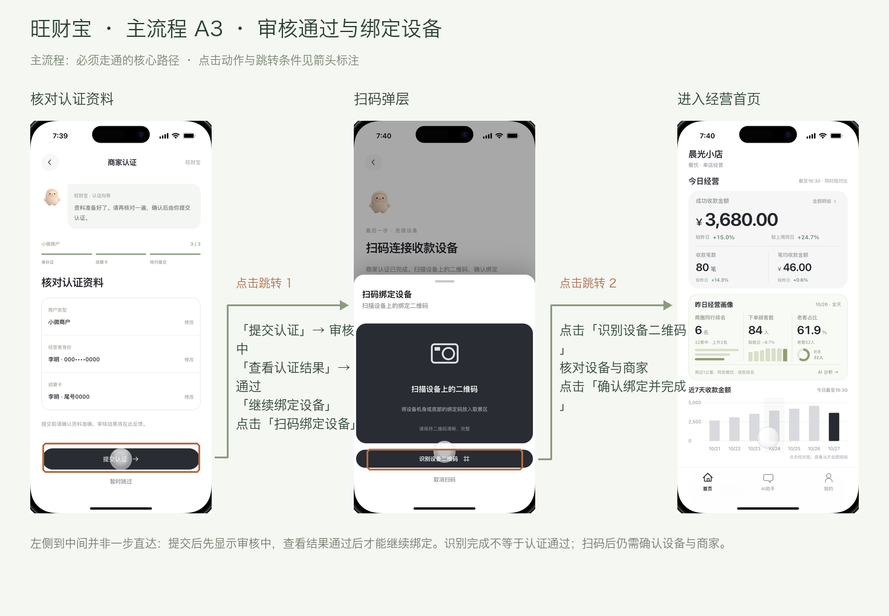

## 主流程 B · 首页查看 → AI 分析 → 继续追问

点击经营画像、AI 洞察或推荐问题也可进入 AI，并携带问题和日期。图中标注底部 AI 助手入口；收款趋势快捷按钮位于对话内容底部，需要下滑。

| 当前页面 | 点击动作与条件 | 目标页面 |
| --- | --- | --- |
| 经营概览 | 点击底部「AI助手」 | AI 助手 |
| AI 助手 | 下滑到常用分析入口 → 点击「收款趋势」 | 图表与文字分析 |

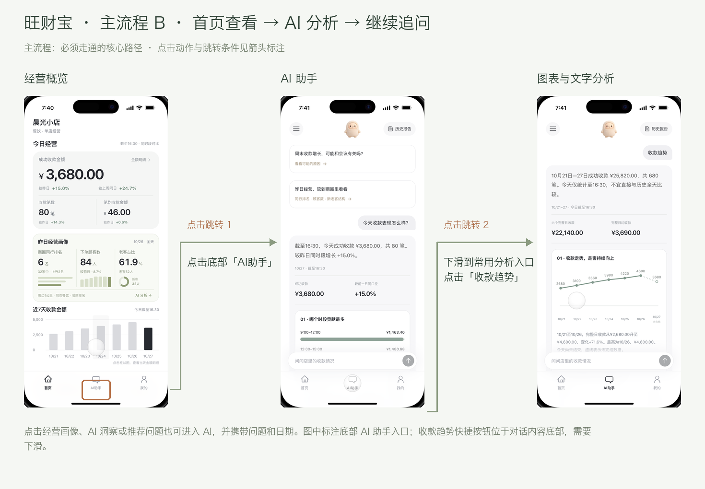

## 支线 · 查看当天金额明细

金额明细在弹层中展示。选择日期后，成功收款与赠送、优惠、退款、积分同步更新；点击趋势柱状图时携带所选日期。点击「完成」关闭弹层返回首页。

| 当前页面 | 点击动作与条件 | 目标页面 |
| --- | --- | --- |
| 首页 | 点击「金额明细」 → 或点击近 7 天某天柱状图 | 金额明细弹层 |

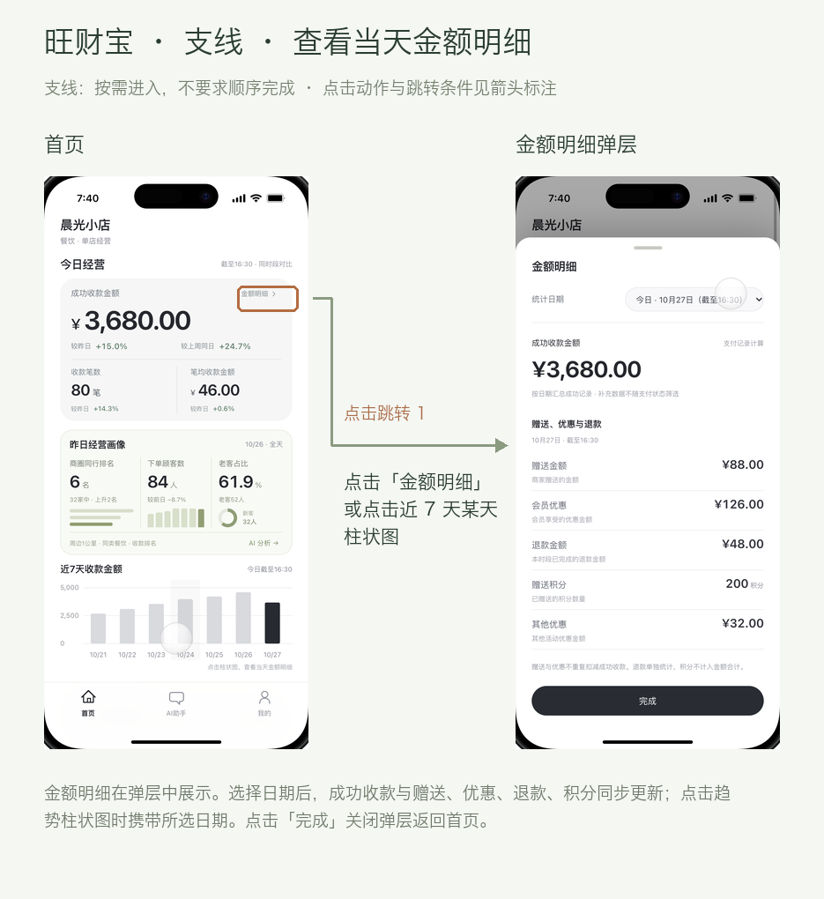

## 支线 · 核对逐笔交易

交易明细入口在首页首屏下方，需要下滑。进入后可按日期和支付状态筛选；点击一笔记录查看唯一 ID、金额、支付时间和结果；顶部返回回到首页。

| 当前页面 | 点击动作与条件 | 目标页面 |
| --- | --- | --- |
| 首页：向下滚动 | 下滑首页 → 点击「交易明细」 | 交易明细 |

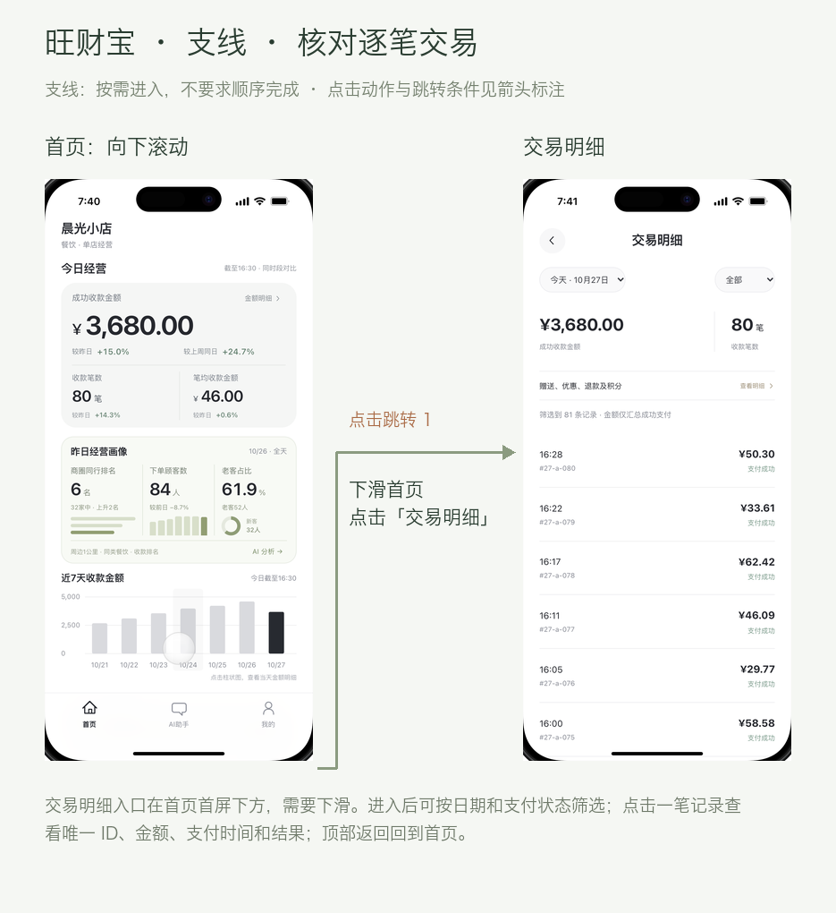

## 支线 · 恢复历史会话

左上角菜单打开侧栏。选择会话后关闭侧栏并恢复整段对话；可搜索、新建会话。右上角关闭按钮收起侧栏。

| 当前页面 | 点击动作与条件 | 目标页面 |
| --- | --- | --- |
| AI 助手 | 点击左上角「历史会话」 | 历史会话侧栏 |

选择某条会话 → 回到 AI 助手并恢复完整上下文

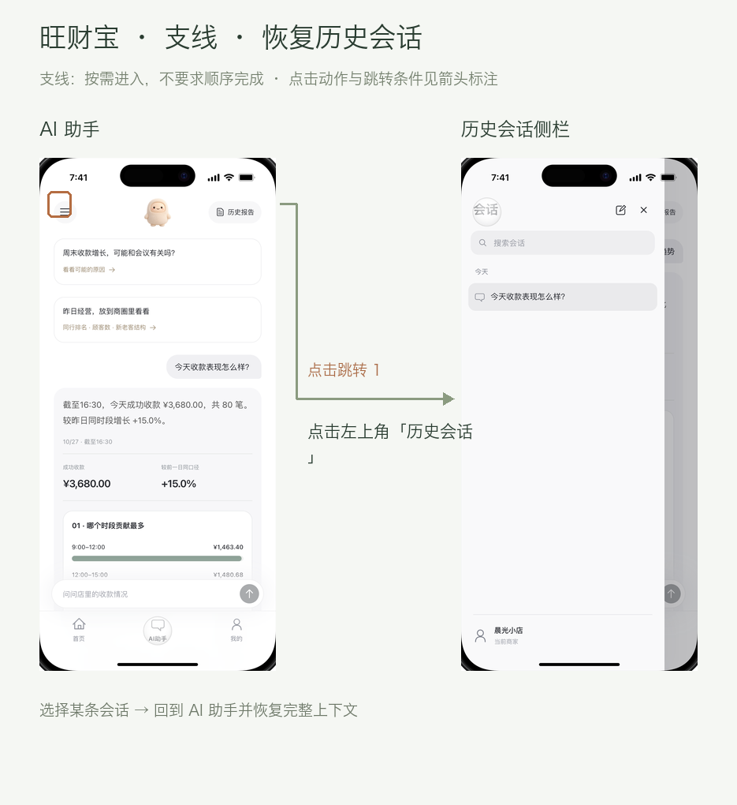

## 支线 · 查看报告并继续追问

历史报告可切换日报、周报，展开报告查看统计及图表。继续问会携带这份报告的日期进入 AI；不是创建一个独立数据分析主页面。

| 当前页面 | 点击动作与条件 | 目标页面 |
| --- | --- | --- |
| AI 助手 | 点击右上角「历史报告」 | 历史报告 |

点击报告中的「就这份报告继续问」→ 返回 AI 助手

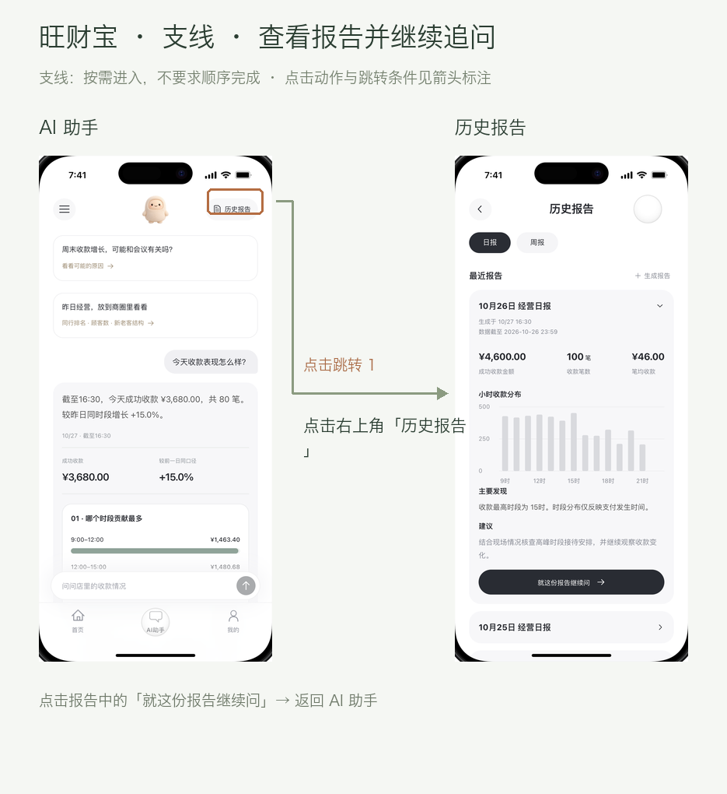

## 支线 · 默认渠道异常时申请备用渠道

进入资料核对必须满足：默认渠道异常 + 商家已认证。正常时不新增申请；未认证先去认证。截图中的签约材料页为已认证场景，复用资料不重复上传。

| 当前页面 | 点击动作与条件 | 目标页面 |
| --- | --- | --- |
| 我的：最新版布局 | 点击「支付渠道」 | 默认及其他支付渠道 |
| 默认及其他支付渠道 | 默认渠道异常且已认证 → 点击「备用支付渠道 A」 | 复用认证资料核对 |

核对并提交 → 审核中 → 查看签约结果 → 已签约、待开通确认；不自动切换默认渠道

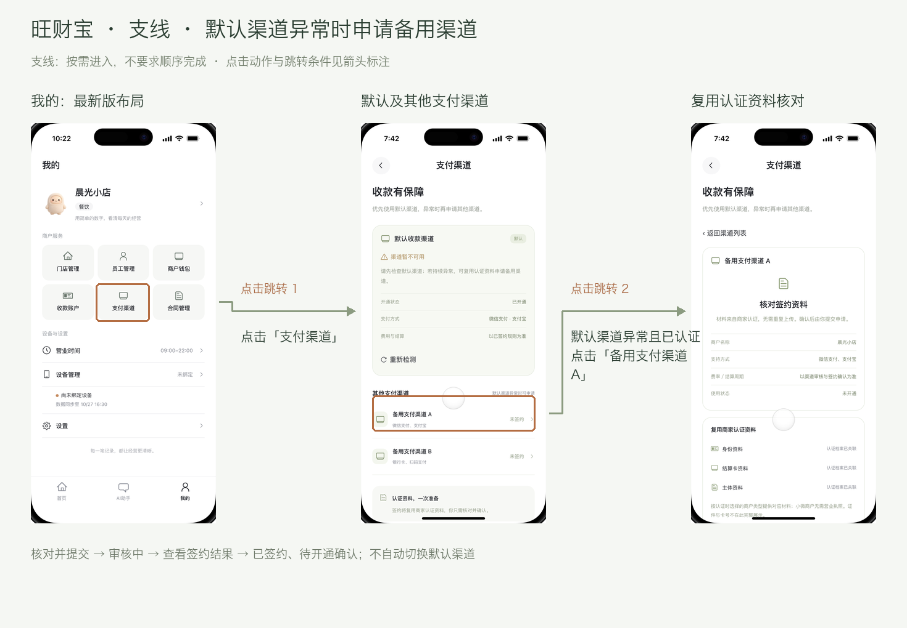

## 支线 · 在我的中绑定设备

设备管理可查看当前绑定状态。未绑定时进入扫码流程；已绑定时显示设备信息及解绑操作。扫码识别后还需显式确认绑定，不直接成功。

| 当前页面 | 点击动作与条件 | 目标页面 |
| --- | --- | --- |
| 我的 | 点击「设备管理」 | 设备管理弹层 |
| 设备管理弹层 | 点击「扫码绑定设备」 | 扫码绑定弹层 |

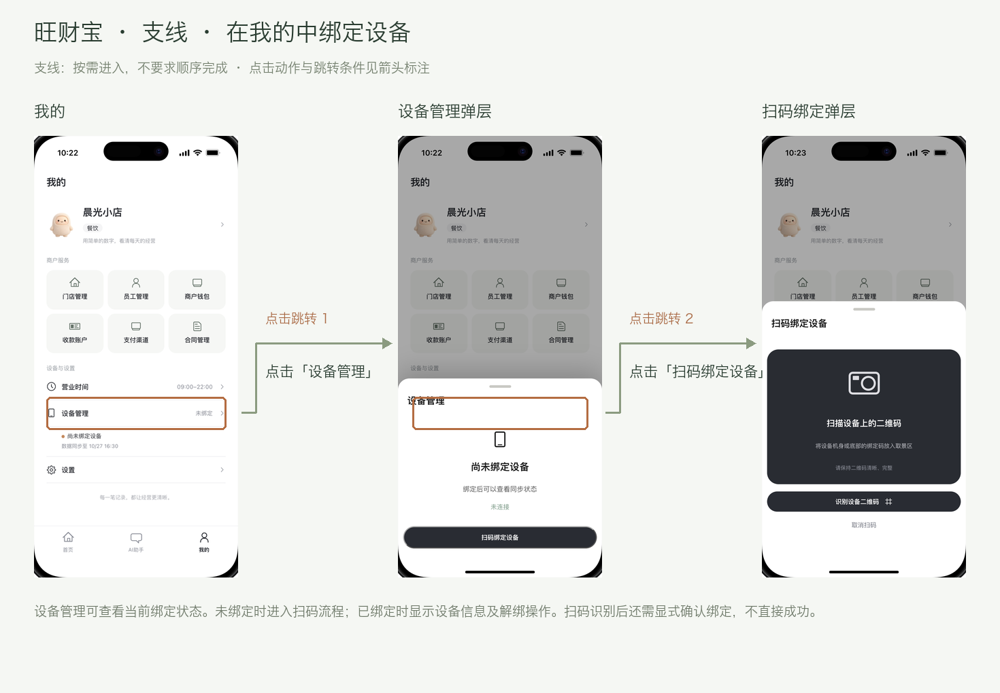

## 支线 · 查看认证状态与导出案例

设置内展示认证状态及 Gold / Bad case 数量，可导出本地案例 JSON。当前还没有独立的商家认证入口；不把未实现入口画成已支持功能。设置截图来自先前已认证场景。

| 当前页面 | 点击动作与条件 | 目标页面 |
| --- | --- | --- |
| 我的 | 点击「设置」 | 账号与设置弹层 |

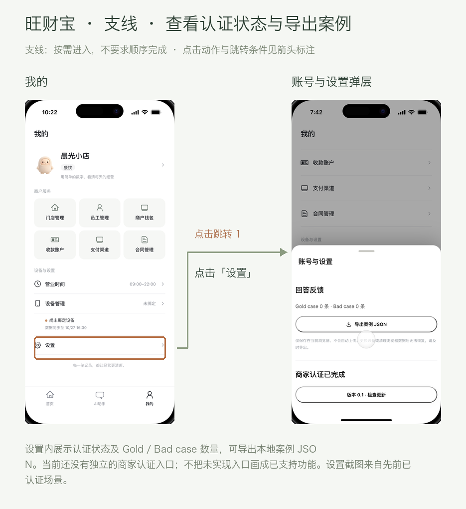
